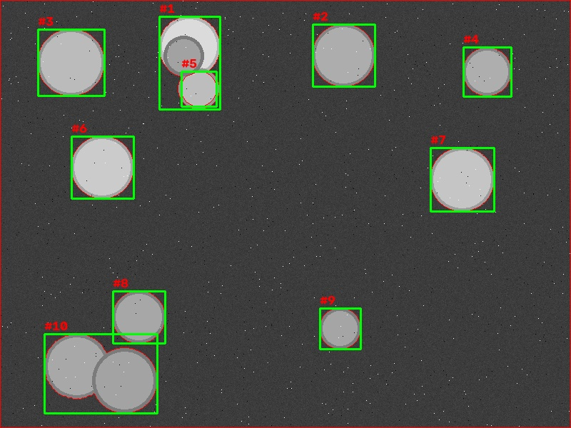
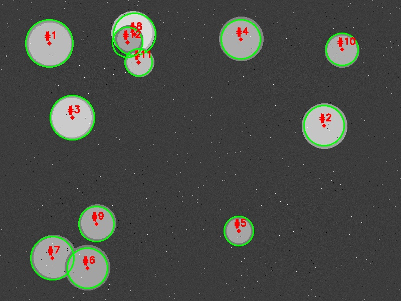
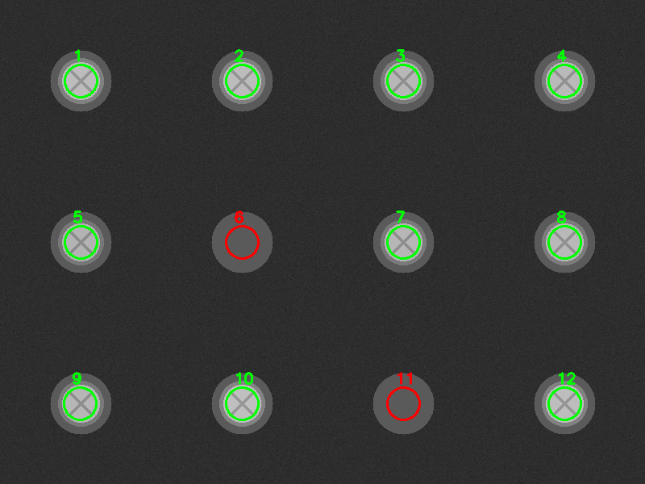

# opencv-industrial-vision

机器视觉应用工程师 10 天求职冲刺的作品集仓库（Day 1–3）。

目标岗位：机器视觉应用 / 视觉调试工程师。所有练习数据均为程序合成（无实拍隐私信息）。

## 目录结构

| 目录 | 内容 | 关键产出 |
|---|---|---|
| `day01_image_basics/` | 图像 I/O（中文路径 imdecode）、像素/ROI/通道、几何变换、绘图、视频采集骨架 | `webcam_demo.py`（滑动平均 FPS + 截图）、抽帧存档器 |
| `day02_vision_pipeline/` | 传统视觉万能流水线：灰度→滤波→阈值→形态学→轮廓→几何筛选；硬币计数（粘连分离） | `pipeline_steps.py`、硬币计数三方案对比 |
| `day03_missing_screw/` | 产线螺丝漏装检测：模板提取 12 个螺丝位 → 逐 ROI 面积判定 → OK/NG + 缺失位标注 | `missing_screw_detect.py`（5/5 全判对）、Halcon 版 `screw_missing.hdev` |

## 核心成果 1：硬币计数三方案（同一算法，OpenCV 与 Halcon 双实现）

测试图含 12 枚硬币，其中两组粘连（一组近乎同心）：

| 方案 | 计数 | 原理与边界 |
|---|---|---|
| 裸轮廓计数 | 9 | 一连通域 = 一物体，粘连即失效 |
| 距离变换 + 分水岭 | 10 | 按"内峰数"拆分个体；近同心重叠时距离变换单峰，原理上无解 |
| HoughCircles 圆先验 | **12** | 边缘点对 (a,b,r) 参数空间投票，可"透视"粘连；代价是参数敏感（param2/minDist） |

选型结论：轻度粘连用分水岭；重叠严重且形状有先验（圆/直线）用霍夫；无先验样本多用深度学习实例分割。




## 核心成果 2：螺丝漏装检测（5/5 判对）

流程：模板图 Otsu 提取 12 个螺丝位中心（Otsu=109，面积筛选 2000–3000）→ 待检图逐位切 ROI → **固定阈值 150** → 白面积 < 800 判缺失 → 终端输出 + 结果图绿框/红框标注。

关键技术点：**ROI 内不用 Otsu**——缺失位的 ROI 中只有孔座(灰度90)与底板(45)，无目标时 Otsu 会强行分割噪声（白面积≈1700 越过门槛），造成全部漏检。固定阈值 150 由灰度分布统计确定：螺丝≥177、孔座 90、底板 45，阈值落在 90 与 177 的空隙中。



Halcon（HDevelop 25.11）等价实现见 `day03_missing_screw/screw_missing.hdev`：`threshold → connection → select_shape → area_center` 提取位置，`gen_circle + reduce_domain + threshold(150)` 逐位判定。领域窗口（domain）不复制像素，是 Halcon 区域运算高效的核心。

## 环境与运行

```bash
# Python 侧
pip install opencv-python numpy
python day03_missing_screw/make_screw_board.py     # 生成测试数据
python day03_missing_screw/missing_screw_detect.py detect
# Halcon 侧：HDevelop 打开 screw_missing.hdev，F5 运行
```

注：`webcam_demo.py` 支持摄像头与视频文件两种源（仓库不含测试视频，任选一段 mp4 修改 `VIDEO_PATH` 即可）。

## 持续更新

Day 4+：PyTorch 迁移学习、YOLO 缺陷检测（NEU-DET）、标定与定位引导、ONNX 部署。
